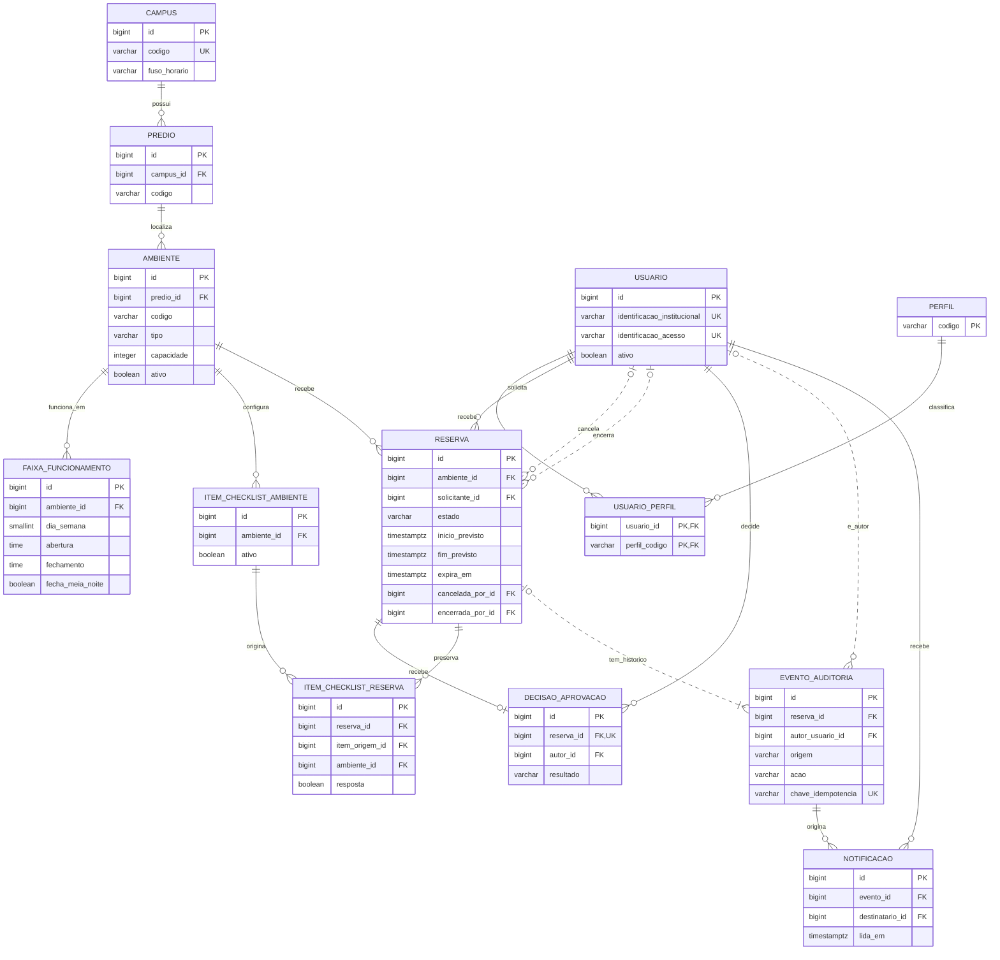

# Modelo lógico — Sistema de Reservas de Salas e Laboratórios

Data: 19/10/2026

Versão: 1.0 — proposta da Etapa 3 para revisão com o grupo e com o backend.

Bases: [Regras do MVP](../requisitos/REGRAS-MVP.md),
[modelo conceitual](MODELO-CONCEITUAL-MVP.md) e configuração integrada à `dev`
pela [PR #5](https://github.com/Project-Lab-UNIMA/sistema-de-reservas-project-lab/pull/5).

O detalhamento de cada coluna está no [dicionário de dados](DICIONARIO-DADOS-MVP.md).
As regras de negócio continuam sendo as da Etapa 1. Nomes, tamanhos, tipos e
estratégias de integridade abaixo são propostas técnicas para orientar o modelo
físico, o Flyway e o JPA; ainda não são migrações executáveis nem implementação.

## 1. Resultado da transformação

As 12 entidades conceituais resultam em **13 tabelas**. A tabela adicional,
`usuario_perfil`, resolve a relação muitos-para-muitos sem duplicar a pessoa.

| Grupo | Tabelas | Responsabilidade |
| --- | --- | --- |
| Estrutura | `campus`, `predio` | Localização e fuso do campus |
| Ambientes | `ambiente`, `faixa_funcionamento`, `item_checklist_ambiente` | Cadastro e configuração atual |
| Pessoas | `usuario`, `perfil`, `usuario_perfil` | Identidade e permissões atuais |
| Reservas | `reserva`, `decisao_aprovacao`, `item_checklist_reserva` | Pedido, decisão única e checklist preservado |
| Histórico | `evento_auditoria`, `notificacao` | Ações imutáveis e avisos internos |

Disponibilidade é calculada. Não há tabela de horários disponíveis, pré-bloqueio
independente, reservas recorrentes, penalidades ou aprovação em duas etapas.

## 2. Diagrama relacional

O diagrama destaca chaves e campos centrais; o dicionário lista todas as colunas.
`PK` identifica a chave primária, `FK` uma referência e `UK` uma chave única.

Cada cópia de checklist referencia a reserva e o item de origem por chaves
compostas que incluem `ambiente_id`. Essa coluna reforça que ambos pertencem ao
mesmo ambiente; não cria uma entidade adicional. A obrigatoriedade de ao menos
um evento por reserva será garantida pela operação transacional de criação,
não por uma FK simples.

## 3. Convenções propostas

- Tabelas e colunas no singular, em português, `snake_case` e sem acentos.
- Identificadores técnicos: `bigint` positivo, gerado por identidade no banco.
  Exceções: `perfil.codigo` é uma chave textual estável; `usuario_perfil` tem PK
  composta. Identificadores não substituem autorização na API.
- Valores de domínio são textos estáveis com `CHECK`, sem ordinal de enum Java.
  Os rótulos exibidos ao usuário podem ter espaços e acentos.
- Textos obrigatórios não aceitam conteúdo vazio após remoção de espaços nas
  extremidades. Limites de tamanho são propostas do dicionário.
- Instantes: `timestamptz(6)`; no Java, `Instant`. O `Clock` já configurado fornece
  o instante de referência da operação. Truncar para microssegundos antes de
  comparar e persistir, evitando diferenças na fronteira entre Java e banco.
- Horários semanais: `time(6) without time zone`, interpretados no fuso do campus.
  Datas de utilização são derivadas dos instantes e do fuso aplicado.
- `timestamptz` identifica o instante, mas não conserva o nome do fuso original;
  guardar o identificador IANA no campus e sua cópia na reserva. Ver
  [tipos de data e hora do PostgreSQL 16](https://www.postgresql.org/docs/16/datatype-datetime.html).
- Durações e tolerâncias são números inteiros de segundos, não horários do dia.
  A antecedência máxima inicial de 30 dias será representada como 2.592.000
  segundos corridos; revisar com o grupo se desejar outra semântica de calendário.
- `versao` em usuário, ambiente e reserva serve ao controle de concorrência por
  JPA `@Version`; não é a versão de uma política.

## 4. Identidade, perfis e autenticação

`usuario` representa a pessoa. `usuario_perfil` representa seus perfis atuais.
O código de perfil pode ser `PROFESSOR`, `MONITOR`, `COORDENACAO` ou `DIRECAO`.
Não há tabelas separadas para professores e monitores.

`identificacao_institucional` é única após `trim`; não presumir matrícula
numérica. `identificacao_acesso` é única após `trim` e conversão para minúsculas,
sem pressupor que todo login seja um e-mail. A mesma normalização deve ser usada
no cadastro, na autenticação e na restrição de unicidade.

Propõe-se `senha_hash` opcional para as contas locais previstas no MVP. Somente
um hash produzido pelo mecanismo de senhas do backend pode ser persistido;
ausência de hash não permite login local. Não há senha padrão na migração.
O provisionamento da primeira direção aproveita as propriedades já existentes,
mas ainda precisa ser implementado. Dados de demonstração ficam separados do
esquema, conforme os perfis `local` e `teste` já configurados.

Os campos de integração com um provedor institucional dependem do contrato de
autenticação. Esta proposta não cria provedor, tabela de sessões ou vínculo SSO.
Se o backend decidir persistir sessões ou identidades externas, suas tabelas
técnicas deverão ser acrescentadas explicitamente ao modelo físico.

A atribuição e a remoção de perfis são auditadas. A primeira conta é criada no
provisionamento; no uso normal, a direção não atribui perfil a si mesma. Remover
um perfil não apaga as decisões e os eventos produzidos quando ele estava ativo.

## 5. Funcionamento e parâmetros do ambiente

Uma faixa identifica um dia ISO da semana (`1` = segunda, `7` = domingo), abertura
e fechamento. `fecha_meia_noite = true` significa fechamento às `00:00` do dia
seguinte; nesse caso `fechamento` deve ser `00:00`. Nos demais casos, abertura é
estritamente anterior a fechamento no mesmo dia. Assim é possível representar
um dia completo sem tentar mapear `24:00` para `LocalTime`.

Faixas do mesmo ambiente e dia não podem se sobrepor; intervalos adjacentes podem
ser tratados como uma faixa contínua. Um funcionamento que cruza a meia-noite é
representado em partes nos respectivos dias. A utilização de uma reserva segue
limitada a uma data; seus buffers precisam caber no funcionamento, inclusive
quando alcançam um dia vizinho. Ausência de cobertura significa indisponibilidade.

Os sete parâmetros atuais ficam no ambiente. Os valores iniciais são:

| Parâmetro | Segundos | Interpretação |
| --- | --- | --- |
| `antecedencia_minima_segundos` | 7200 | 2 horas |
| `antecedencia_maxima_segundos` | 2592000 | 30 dias corridos |
| `duracao_maxima_segundos` | 14400 | 4 horas de utilização |
| `preparacao_segundos` | 900 | 15 minutos antes |
| `limpeza_segundos` | 900 | 15 minutos depois |
| `tolerancia_check_in_segundos` | 900 | 15 minutos, com limite inclusivo |
| `prazo_pre_bloqueio_segundos` | 86400 | Até 24 horas, limitado pelo início |

Guardar esses parâmetros não autoriza novas telas de configuração nem exceções
às regras. Antes de reduzir capacidade/funcionamento ou inativar ambiente, a
operação deve verificar as reservas futuras afetadas, com proteção concorrente
contra novos pedidos durante a alteração.

## 6. Reserva e preservação das regras

Na criação, copiar para a reserva os sete parâmetros, a capacidade e o fuso
efetivamente usados. Preservar também solicitante, ambiente, finalidade,
participantes e instantes de início/fim. Os campos de identificação e configuração
aplicada não são editáveis após o envio.

`participantes_previstos` é obrigatório e positivo na proposta; não pode exceder
a capacidade aplicada. Essa validação explicita a finalidade da capacidade já
presente no DER e deve ser confirmada com o grupo antes da implementação.

São persistidos três instantes calculados na criação:

- `expira_em = mínimo(criada_em + prazo aplicado, inicio_previsto)`.
- `ocupacao_inicio = inicio_previsto - preparação aplicada`.
- `ocupacao_fim = fim_previsto + limpeza aplicada`.

Os limites de ocupação são redundâncias controladas, úteis à restrição contra
sobreposição. O modelo físico deverá validar sua correspondência com os campos
de origem e impedir sua alteração isolada, por trigger ou mecanismo equivalente.
Uma coluna gerada não deve ser prometida sem verificar a imutabilidade da
expressão no PostgreSQL. Os cálculos usam duração em segundos e instantes UTC.

O intervalo é `[ocupacao_inicio, ocupacao_fim)`: inclui o começo e exclui o fim.
Esse formato permite adjacência e pode ser representado por `tstzrange`, conforme
os [tipos de intervalo do PostgreSQL 16](https://www.postgresql.org/docs/16/rangetypes.html).

### 6.1 Estados e efeito sobre o intervalo

| Estado persistido | Mantém a ocupação programada? | Condição |
| --- | --- | --- |
| `PENDENTE` | Sim, enquanto válido | `agora < expira_em` |
| `APROVADA` | Sim, enquanto a entrada ainda é possível | Se não houver check-in e a janela fechar, deve virar `NAO_COMPARECEU` |
| `EM_USO` | Sim | Sem extensão automática após o término |
| `ENCERRADA` | Sim, até o fim do intervalo originalmente programado | Inclui encerramento antecipado e administrativo |
| `RECUSADA`, `CANCELADA`, `EXPIRADA`, `NAO_COMPARECEU` | Não | O histórico e os limites originais permanecem |

O bloqueio de `ENCERRADA` não ocupa a sala indefinidamente: só conserva o
intervalo original. Pendência de encerramento continua derivada:
`estado = EM_USO` e `agora >= fim_previsto`.

### 6.2 Check-in e término

O check-in exige simultaneamente:

1. Estado `APROVADA` e identidade do solicitante.
2. `inicio_previsto <= agora < fim_previsto`.
3. `agora <= inicio_previsto + tolerancia_check_in_segundos_aplicada`.

Sem entrada, a janela fecha quando `agora >= fim_previsto` **ou**
`agora > inicio_previsto + tolerância`. Não reduzir essas duas fronteiras a um
único prazo inclusivo: no término o check-in é proibido; na tolerância exata ele
ainda pode ser permitido. `check_in_em` é preservado em `EM_USO` e `ENCERRADA`.

Cancelamento guarda momento, autor, tipo e motivo. Encerramento guarda momento,
autor, tipo e justificativa administrativa quando aplicável. O momento registrado
não é uma comprovação do instante físico de saída. A decisão de aprovação fica
separada e permanece mesmo após cancelamento.

## 7. Checklist e decisão única

A decisão tem uma FK única para a reserva: no máximo uma decisão por pedido.
`resultado` aceita `APROVADA` ou `RECUSADA`; recusa exige motivo. Autor, resultado,
momento e motivo tornam-se imutáveis. A comparação entre autor e solicitante
impede autoaprovação por pessoa, inclusive quando ela acumula perfis.

Ao criar a reserva, copiar os itens ativos do ambiente na mesma transação.
Cada cópia conserva descrição, ordem e obrigatoriedade; o item de origem nunca é
apagado. `UNIQUE(reserva_id, item_origem_id)` impede cópia duplicada.

Para garantir o mesmo ambiente no banco, propor:

- Chave única adicional `(id, ambiente_id)` em `reserva` e em
  `item_checklist_ambiente`.
- FK composta `(reserva_id, ambiente_id)` para a reserva.
- FK composta `(item_origem_id, ambiente_id)` para o item configurado.

A resposta começa `NULL` (não respondido); `false` é resposta negativa e `true`
é confirmação. Resposta e `respondida_em` são preenchidos juntos, pelo solicitante
durante `EM_USO`, e não mudam após encerramento. Fechamento normal exige `true`
em todos os itens obrigatórios preservados. Fechamento administrativo exige
justificativa e não inventa respostas nem confirmações em nome do solicitante.

## 8. Concorrência e divisão de responsabilidades

O PostgreSQL pode impedir sobreposição com uma restrição de exclusão GiST por
ambiente e intervalo, apoiada por `btree_gist`. Essa é a estratégia candidata
citada por Gabriel; a migração e os testes ainda precisarão demonstrá-la.

### 8.1 Protocolo proposto para ocupação

Toda operação que altera ocupação, faixa, checklist ou configuração relevante
deve coordenar-se pelo registro do ambiente:

1. Iniciar transação e bloquear o ambiente para escrita. Se houver mais de um,
   ordenar por ID. Bloquear as reservas envolvidas depois do ambiente, em ordem
   de ID; tarefas automáticas também seguem essa ordem.
2. Obter um instante do `Clock` **após** adquirir os bloqueios e usá-lo nas
   validações da operação. Não reutilizar um instante anterior a uma espera longa.
3. Antes de validar conflitos, efetivar pendências expiradas e aprovações sem
   entrada cuja janela já fechou naquele ambiente. Registrar as transições e
   seus eventos na mesma transação.
4. Revalidar permissão, estado, prazo, funcionamento, capacidade e intervalo;
   copiar a configuração/checklist se for criação.
5. Persistir reserva, decisão quando houver, auditoria e avisos exigidos juntos;
   confirmar a transação. Conflito ou falha desfazem os efeitos dessa tentativa.

Como o predicado de uma exclusão não muda com a passagem do tempo, a candidata
é restringir os estados persistidos `PENDENTE`, `APROVADA`, `EM_USO` e `ENCERRADA`.
Por isso o passo 3 é indispensável: não depender só do agendador para remover
bloqueios já vencidos. Não usar `now()` em predicado de índice para tentar
obter expiração automática. Ver as exigências de imutabilidade em
[CREATE INDEX](https://www.postgresql.org/docs/16/sql-createindex.html).

Consultas de disponibilidade devem interpretar prazos vencidos mesmo antes da
atualização do estado, e o salvamento deve repetir a validação sob bloqueio.
Uma consulta livre anterior nunca garante a reserva. Traduza o conflito de
exclusão para uma resposta de negócio; não exponha erro SQL ao usuário.

`@Version` ajuda a detectar alterações perdidas, mas não substitui esse protocolo
nem a garantia de não sobreposição. Expiração e não comparecimento devem ser
idempotentes; a chave única do evento automático reforça essa proteção.

### 8.2 O que pode ser garantido em cada camada

| Invariante | Garantia proposta no banco | Garantia do serviço transacional |
| --- | --- | --- |
| Referências e registros obrigatórios | PK, FK, `NOT NULL` | Autorização de acesso |
| Uma pessoa por identificação e um vínculo por perfil | `UNIQUE` e PK composta | Normalização no cadastro/login |
| Início anterior ao fim; valores positivos | `CHECK` sobre a própria linha | Datas válidas, finitas e fuso IANA reconhecido |
| Uma decisão por reserva | `UNIQUE(reserva_id)` | Estado pendente, prazo, perfil e impedimento de autoaprovação |
| Checklist da mesma sala | FKs compostas e unicidade da cópia | Snapshot completo sob bloqueio do ambiente |
| Não sobreposição | Exclusão GiST proposta | Normalizar vencimentos e revalidar ao gravar |
| Consistência entre estado, decisão e marcos | `CHECK` local; triggers entre tabelas a detalhar | Transição permitida com os registros associados na mesma transação |
| Encerramento normal completo | Integridade e pares resposta/instante | Conferir todos os itens obrigatórios; identificar autor e tipo |
| Auditoria e decisões imutáveis | Triggers de rejeição de alteração/exclusão a detalhar | Sempre criar evento ao concluir ação |
| Alteração de ambiente com reservas futuras | FKs preservam referências | Bloquear ambiente e verificar os pedidos afetados |

Uma FK não obriga o pai a ter filhos, e um `CHECK` de uma linha não valida perfis,
outras tabelas ou o estado de todas as respostas. Não apresentar essas garantias
como resolvidas apenas com JPA ou com `CHECK`. A distinção segue a documentação
de [restrições do PostgreSQL 16](https://www.postgresql.org/docs/16/ddl-constraints.html).

## 9. Auditoria, notificações e preservação

`evento_auditoria.reserva_id` é uma FK real para os eventos do ciclo da reserva.
Eventos humanos exigem `autor_usuario_id`; eventos do sistema deixam esse campo
nulo e indicam `origem = SISTEMA`. `ocorrido_em` é o momento de processamento;
prazos efetivos de automações ficam identificados nos dados do evento e na reserva.

Para ações administrativas gerais, `alvo_tipo` e `alvo_chave` identificam
historicamente o objeto. `alvo_chave` é textual para representar também a PK de
perfil e a PK composta de `usuario_perfil`. **Esse par não é FK polimórfica e
não tem integridade referencial automática.** O serviço deve usar tipos de alvo
permitidos, extrair a chave do objeto alterado e gravar o evento na mesma transação.
Eventos de transição da reserva usam `alvo_tipo = RESERVA`, sua chave e sua FK
coerentes. `CHECKLIST_RESPONDIDO` identifica o item copiado como alvo e mantém
a FK de reserva; o serviço confere que o item pertence àquela reserva.

`dados_antes` e `dados_depois` são objetos JSON de histórico, com campos permitidos
explicitamente por tipo de ação. Não substituem relações nem armazenam a reserva
inteira como fonte principal. Senhas, hashes, tokens e segredos são excluídos até
na criação e na alteração de usuários. Auditar a existência de mudança de
credencial sem copiar seu conteúdo.

Exemplos de chave idempotente: `reserva:<id>:expiracao` e
`reserva:<id>:nao_comparecimento`. Eventos humanos podem deixar essa chave nula;
o bloqueio e a validação de estado continuam necessários.

Cada notificação aponta para um evento e um destinatário. A unicidade desse par
impede avisos duplicados ao repetir uma rotina. O conteúdo é preservado e apenas
`lida_em` pode passar de nulo para o instante de leitura pelo destinatário.
O aviso obrigatório de cancelamento administrativo é criado na mesma transação
do cancelamento. Outros eventos notificáveis dependem de decisão do grupo;
não se pressupõe envio de e-mail.

Usuários e ambientes são inativados; itens configurados são inativados. Reservas,
decisões, cópias de checklist e eventos históricos não são excluídos para liberar
a agenda. FKs históricas usam `RESTRICT`, sem exclusão em cascata nem remoção do
autor por `SET NULL`. A associação `usuario_perfil` pode ser removida, com evento
de auditoria, pois representa a permissão atual. Não existe processo de expurgo
definido nesta etapa; qualquer política futura deve tratar o histórico explicitamente.

## 10. Índices candidatos para a etapa física

Os índices de PK e unicidade já atendem parte dos acessos. Evitar criar índices
duplicados antes de conferir o plano de execução e os índices gerados pelas
restrições. FKs não criam automaticamente índices no lado que referencia.

| Consulta ou garantia | Candidato |
| --- | --- |
| Prédios de um campus e código único | Único `(campus_id, codigo)` |
| Ambientes de um prédio e código único | Único `(predio_id, codigo)` |
| Funcionamento por ambiente e dia | `(ambiente_id, dia_semana, abertura)`; exclusão de faixas a detalhar |
| Pessoas por perfil | `(perfil_codigo, usuario_id)` além da PK inversa |
| Reservas do solicitante | `(solicitante_id, inicio_previsto, id)` |
| Reservas futuras do ambiente | `(ambiente_id, estado, inicio_previsto)` |
| Ocupações conflitantes | GiST da restrição de exclusão |
| Pendentes a expirar | `expira_em`, parcial para `PENDENTE` |
| Aprovadas a verificar | `inicio_previsto`, parcial para `APROVADA`; considerar também o término e a tolerância aplicada |
| Checklist configurado e copiado | Unicidades do dicionário e índice por FK de origem |
| Autor de decisão/cancelamento/encerramento | Índices nas FKs se os acessos/checagens justificarem |
| Histórico da reserva em ordem estável | `(reserva_id, ocorrido_em, id)` |
| Autor humano e alvo administrativo | `(autor_usuario_id, ocorrido_em)` e `(alvo_tipo, alvo_chave, ocorrido_em)` |
| Notificações do destinatário | `(destinatario_id, criada_em, id)`; parcial de não lidas a avaliar |

## 11. Critérios de revisão antes das migrações

Os itens abaixo precisam ser conferidos com o backend; esta proposta oferece uma
escolha concreta para cada um, sem presumir aprovação do grupo:

- [ ] Nomes, `bigint`, PK textual de perfil e PK composta da associação.
- [ ] Tamanhos de texto, login normalizado e representação da autenticação local.
- [ ] Participantes obrigatórios e limite pela capacidade aplicada.
- [ ] Segundos corridos para antecedência, precisão e faixas até meia-noite.
- [ ] Snapshots, limites de ocupação persistidos e mecanismo de consistência.
- [ ] Exclusão GiST, `btree_gist` e ordem de bloqueios, inclusive nas tarefas.
- [ ] Alvos administrativos sem FK genérica e campos permitidos no JSON histórico.
- [ ] Relação dos estados com decisão, cancelamento, entrada e encerramento.
- [ ] Divisão do trabalho: quem escreve e revisa as migrações e os mapeamentos JPA.

## 12. Cenários que a implementação deverá demonstrar

| Caso | Resultado esperado |
| --- | --- |
| Pessoa com Professor e Direção | Um usuário, dois vínculos; autoaprovação rejeitada |
| Dois pedidos simultâneos sobrepostos | Apenas uma ocupação válida, inclusive se o conflito for só de buffers |
| Ocupações que apenas se encostam | Ambas permitidas se atenderem às demais regras |
| Pré-bloqueio vencido e agendador parado | Consulta e novo pedido não ficam bloqueados por estado desatualizado |
| Aprovação disputando com expiração | Uma transição válida, sem decisão tardia nem evento duplicado |
| Check-in disputando com não comparecimento | Uma transição válida, sob o mesmo protocolo de bloqueio |
| Reserva 14h–16h, entrada às 14h15 | Aceita; após esse instante, rejeitada |
| Reserva 14h–14h10 ou 14h–14h15, entrada no término | Rejeitada, mesmo se a tarefa ainda não executou |
| Encerramento antecipado | Intervalo original, inclusive limpeza, continua protegido |
| Encerramento administrativo | Autor e justificativa presentes, sem fabricar respostas de checklist |
| Alteração posterior de parâmetros/checklist | Reservas antigas mantêm suas cópias |
| Cópia de item de outro ambiente | FK composta impede a gravação |
| Redução de funcionamento/capacidade ou inativação com pedido futuro afetado | Alteração bloqueada até tratar as reservas |
| Repetição de tarefa automática ou notificação | Sem nova transição indevida nem duplicação de efeitos |
| Tentativa de alterar decisão ou evento histórico | Banco rejeita; correção rastreável exige novo evento |

Após a revisão desta Etapa 3, a etapa seguinte será escrever as migrações Flyway,
mapear as entidades JPA, separar os dados locais de demonstração e criar testes
de integração com PostgreSQL 16. O perfil `teste` deve ser ativado nesses testes;
o teste de contexto atual, sozinho, não demonstra as garantias desta proposta.
